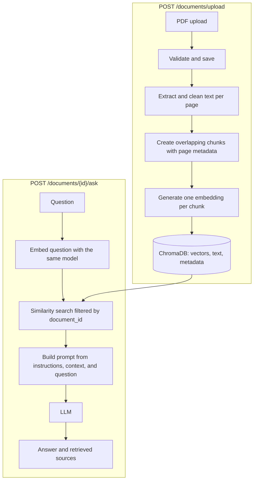

# PDF Q&A API

A lightweight **Retrieval-Augmented Generation (RAG)** backend built with FastAPI. Upload a PDF, ask questions about its contents, and receive an answer with the retrieved text chunks used as sources.

The implementation keeps the RAG pipeline explicit and easy to follow, without LangChain or agent frameworks:

**Parse → Chunk → Embed → Store → Retrieve → Generate**

> **Core design principle:** each vector represents one text chunk, not an entire PDF. A document split into 40 chunks produces 40 vectors.

## Contents

- [Features](#features)
- [How it works](#how-it-works)
- [Project structure](#project-structure)
- [Requirements and configuration](#requirements-and-configuration)
- [Run locally](#run-locally)
- [API usage](#api-usage)
- [Testing](#testing)
- [Docker](#docker)
- [Railway deployment](#railway-deployment)
- [Security considerations](#security-considerations)
- [Limitations](#limitations)
- [Possible multimodal extension](#possible-multimodal-extension)
- [Design decisions](#design-decisions)

## Features

- Upload and validate PDF files through a REST API.
- Extract text page by page and preserve page metadata.
- Split text into overlapping chunks without crossing page boundaries.
- Generate embeddings in batches and store vectors, text, and metadata in ChromaDB.
- Retrieve relevant chunks for a question, scoped to the requested document.
- Return the generated answer together with retrieved source chunks and retrieval scores.
- Configure the LLM, embedding provider, chunking, and storage through environment variables.
- Run unit tests without external API calls; optionally run integration tests against a real provider.
- Run locally or in Docker.

## How it works



### Ingestion flow

1. Validate the file extension, size, and PDF signature.
2. Save the uploaded file under `data/uploads/<uuid>.pdf`.
3. Extract and clean text page by page. Blank pages are skipped, while page numbers are preserved.
4. Split each page into overlapping chunks. Chunks do not cross page boundaries.
5. Generate embeddings in batches.
6. Store each chunk, its vector, and metadata in ChromaDB.

Chunk metadata includes `document_id`, `filename`, `page`, `chunk_index`, `num_pages`, and `created_at`.

### Question-answering flow

1. Check that the requested document exists.
2. Embed the question using the configured embedding model.
3. Search ChromaDB with a `document_id` filter so results come from that document only.
4. Build a prompt from the system instructions, retrieved context, and question.
5. Call the language model and return its answer with the retrieved chunks.

### Chunk size and overlap

Chunk size controls how much text each vector represents and how much context can be supplied to the model per retrieved result. Overlap repeats some text at adjacent chunk boundaries, reducing the chance that a sentence split between chunks becomes difficult to retrieve.

The chunker prefers paragraph, line, sentence, and then word boundaries. It keeps each chunk within a single page so every chunk has one page number.

> **Changing `EMBEDDING_MODEL` after ingestion:** existing vectors may no longer be compatible with question embeddings. Re-ingest the documents or point `CHROMA_PATH` to a fresh database.

## Project structure

```text
app/
  main.py                 FastAPI app, logging, and /health
  api/
    deps.py               Vector-store dependency
    routes/
      documents.py        Upload and document metadata endpoints
      qa.py               Question-answering endpoint
  core/
    config.py             Environment-based settings
  schemas/                Pydantic request and response models
  services/
    pdf_parser.py         Page-by-page PDF text extraction and cleaning
    chunker.py            Deterministic overlapping chunking
    embeddings.py         Batched embedding requests
    vector_store.py       ChromaDB wrapper and document filtering
    qa.py                 Prompt construction, retrieval, and LLM call
tests/                    Unit tests and optional integration tests
data/                     Runtime uploads and ChromaDB files (git-ignored)
```

## Requirements and configuration

You need Python, an API key for your selected LLM/embedding provider, and the dependencies listed in `requirements-dev.txt`. The defaults target OpenAI-compatible APIs.

| Variable | Default | Purpose |
|---|---|---|
| `OPENAI_API_KEY` | Required | LLM API key; also used for embeddings unless overridden |
| `OPENAI_BASE_URL` | Provider default | Base URL for an OpenAI-compatible API |
| `EMBEDDING_API_KEY` | Falls back to `OPENAI_API_KEY` | Optional separate embedding API key |
| `EMBEDDING_BASE_URL` | Falls back to `OPENAI_BASE_URL` | Optional separate embedding endpoint |
| `LLM_MODEL` | `gpt-4o-mini` | Chat model |
| `EMBEDDING_MODEL` | `text-embedding-3-small` | Embedding model |
| `CHROMA_PATH` | `data/chroma` | ChromaDB persistence directory |
| `UPLOAD_DIR` | `data/uploads` | Directory for uploaded PDFs |
| `CHUNK_SIZE` | `1000` | Chunk size in characters |
| `CHUNK_OVERLAP` | `200` | Overlap in characters; must be smaller than chunk size |
| `TOP_K` | `4` | Number of chunks retrieved per question |
| `MAX_UPLOAD_MB` | `20` | Maximum upload size in MB |
| `EMBEDDING_BATCH_SIZE` | `64` | Number of texts per embedding request |
| `LOG_LEVEL` | `INFO` | Application logging level |

See [`.env.example`](.env.example) for the available environment variables.

## Run locally

Create and activate a virtual environment, install the development requirements, and configure your API key:

```bash
python -m venv .venv

# macOS / Linux
source .venv/bin/activate

# Windows PowerShell
# .venv\\Scripts\\Activate.ps1

pip install -r requirements-dev.txt
cp .env.example .env
```

Add your provider key to `.env`, then start the server:

```bash
uvicorn app.main:app --reload
```

- Interactive API documentation: http://localhost:8000/docs
- Health check: http://localhost:8000/health

## API usage

### 1. Check the service

```bash
curl http://localhost:8000/health
```

Example response:

```json
{"status":"ok"}
```

### 2. Upload a PDF

```bash
curl -X POST http://localhost:8000/documents/upload \
  -F "file=@report.pdf"
```

Example response (illustrative):

```json
{
  "document_id": "6f1c...",
  "filename": "report.pdf",
  "num_pages": 12,
  "num_chunks": 38,
  "status": "processed"
}
```

Keep the returned `document_id`; use it for document lookup and questions.

### 3. Get document metadata

```bash
curl http://localhost:8000/documents/6f1c...
```

### 4. Ask a question

```bash
curl -X POST http://localhost:8000/documents/6f1c.../ask \
  -H "Content-Type: application/json" \
  -d '{"question":"What are the main conclusions?"}'
```

The response contains the document ID, question, generated answer, and retrieved sources. Each source includes fields such as page, chunk index, text, and score. Exact response values depend on the uploaded PDF and model output.

**Interpreting `score`:** it is a similarity-based retrieval signal, not a calibrated confidence score and not proof that an answer is correct.

### HTTP status codes

| Status | Meaning |
|---|---|
| `201` | PDF accepted and processed |
| `400` | Empty, corrupt, or encrypted PDF |
| `404` | Document not found |
| `413` | Upload exceeds `MAX_UPLOAD_MB` |
| `415` | File is not accepted as a PDF |
| `422` | Invalid document ID, invalid question, or PDF with no extractable text |
| `502` | Embedding or LLM provider error |
| `500` | Vector-store failure |

Provider error details are logged rather than returned directly to the client.

## Testing

Run the unit suite:

```bash
pytest
```

Unit tests do not require network access or a real API key. They create PDFs with PyMuPDF, mock embedding and LLM calls, and use a temporary ChromaDB instance to exercise document-level filtering.

To run the optional integration tests with real API calls:

```bash
RUN_INTEGRATION=1 OPENAI_API_KEY=your-api-key pytest -m integration
```

## Docker

Build and run the container:

```bash
docker build -t pdf-qa .
docker run --rm -p 8000:8000 --env-file .env \
  -v pdfqa-data:/app/data pdf-qa
```

To use a custom port:

```bash
docker run --rm -e PORT=9000 -p 9000:9000 \
  --env-file .env -v pdfqa-data:/app/data pdf-qa
```

The container starts Uvicorn on `0.0.0.0` and uses `PORT` when provided, defaulting to `8000`.

## Railway deployment

1. Push the repository to GitHub and create a Railway project from the repository. Railway can detect the included Dockerfile.
2. Set `OPENAI_API_KEY` and any required optional variables in the service variables.
3. Add a persistent volume mounted at `/app/data`; otherwise, uploaded PDFs and local vector data will not persist across redeployments.
4. Generate a public domain in the service networking settings.
5. Open `/docs` to explore the API. You can optionally configure `/health` as the health-check path.

Use **a single replica** with the current local ChromaDB setup. Its local-file persistence is not designed for multiple service instances writing concurrently.

## Security considerations

The system prompt instructs the model to answer from retrieved context and treat that context as untrusted data. Retrieved chunks are wrapped in `<chunk>` tags, with angle brackets escaped to make it harder for PDF text to break out of the context block.

This is a mitigation, **not a guarantee** against prompt injection. The API also currently has no authentication or authorization: a person who obtains a document ID may be able to query that document. Do not expose sensitive documents publicly without adding appropriate access controls.

## Limitations

- **Text-based PDFs only:** scanned PDFs are not OCR-processed and return `422` when no text can be extracted. Images, charts, and visual layout are not interpreted; tables may be extracted as plain text.
- **No authentication or authorization:** document IDs are random UUIDs, but they are not a substitute for access control. There are no list or delete endpoints.
- **Synchronous ingestion:** large PDFs can make upload requests slow.
- **Character-based chunking:** chunk size is measured in characters, not tokens.
- **Vector search only:** there is no keyword/hybrid search or re-ranking. Questions requiring comprehensive coverage of an entire document may perform poorly when only the top-K chunks are retrieved.
- **Local persistence:** the current storage setup suits a single instance and requires a persistent volume in deployment.
- **Source attribution is limited:** source pages are inherited from retrieved chunks; page references generated in the answer are not independently verified. Returned sources show retrieved context, not formal citations.
- **Retrieval and answer quality are not guaranteed:** relevant text may not be retrieved, and the model may still produce an unsupported answer.

## Possible multimodal extension

The current implementation is text-only. A future extension could represent text, images, charts, and tables as separate retrievable items that point back to the same document section.

| Content | Possible stored representation | Possible embedding |
|---|---|---|
| Text | Extracted text | Text embedding |
| Image or chart | Vision-generated caption, or the image itself | Caption embedding or image/multimodal embedding |
| Table | Markdown/CSV text and optionally a short summary | Embedding of the table text or summary |

Each item could carry metadata such as `document_id`, `page`, `section_id`, `modality`, and `source_ref`. Retrieval could search across modalities, combine hits belonging to the same section, and pass supported text/image inputs to a multimodal model.

In this design, **multi-vector** means several vectors for different representations of one section—not one vector containing the entire document. These are possible future directions, not capabilities of the current code.

## Design decisions

- **One ChromaDB collection with metadata filtering:** simpler than creating a collection per PDF. The `document_id` filter is applied inside `VectorStore.query`, reducing the risk that a route forgets to scope retrieval.
- **Explicit embeddings:** vectors are generated by the configured embedding model and passed to ChromaDB, avoiding accidental use of ChromaDB's default embedding function.
- **Consistent embedding model:** documents and questions must use compatible embedding models. Changing the model requires re-ingestion or a fresh vector database.
- **Cosine similarity:** cosine distance is converted to a similarity score for the API response; this score should not be interpreted as answer confidence.
- **Synchronous route handlers:** blocking SDK and ChromaDB operations are kept straightforward; FastAPI runs standard synchronous handlers in a thread pool.
- **Service-level errors:** services raise specific exceptions such as `EmbeddingError`, `LLMError`, and `VectorStoreError`; routes translate them into HTTP status codes and client-safe messages.
